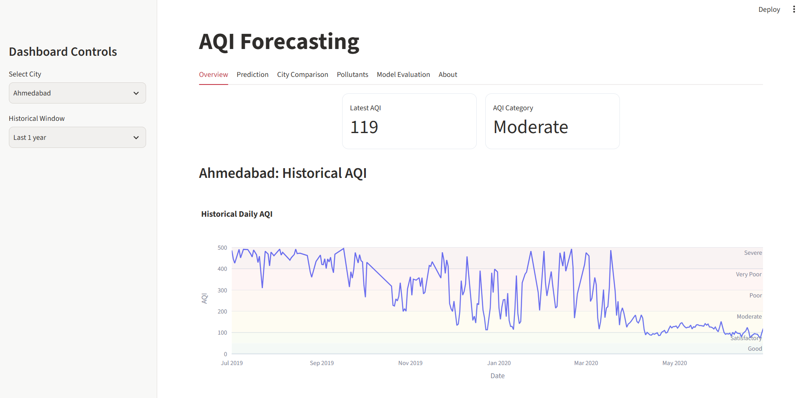
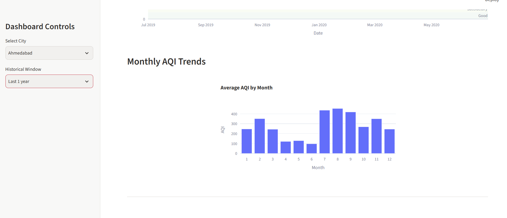
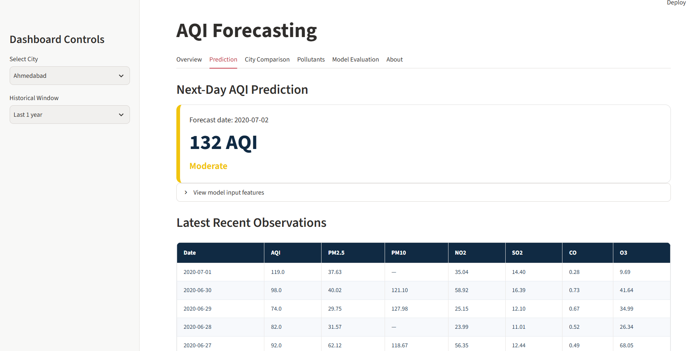
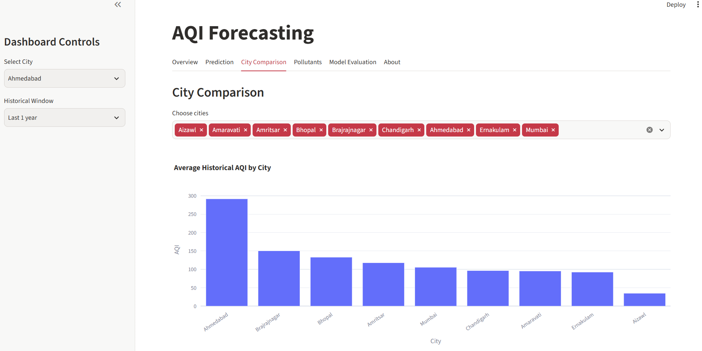
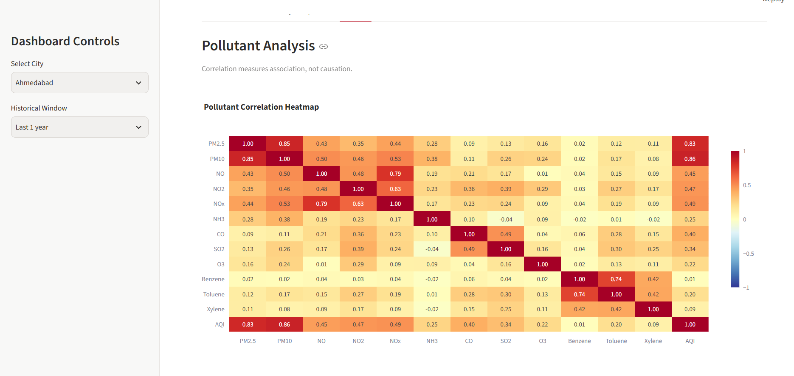
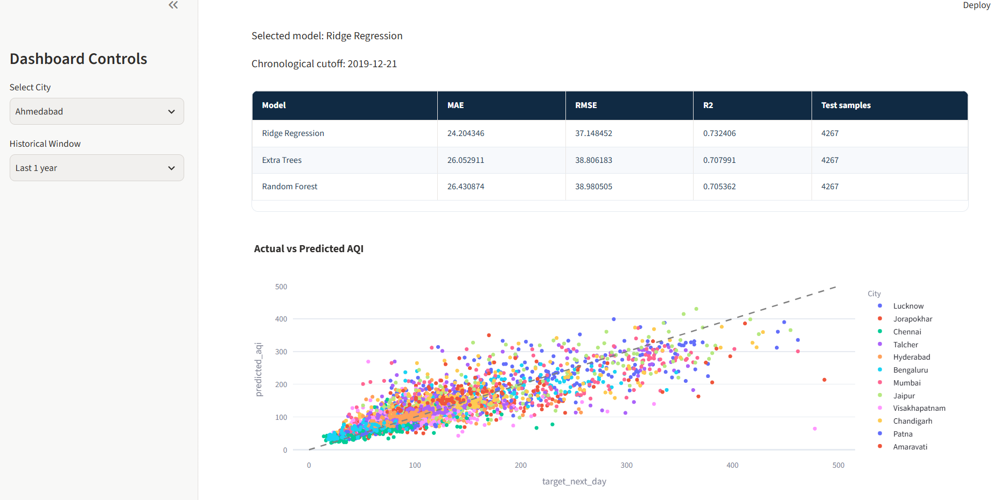

# India AQI Forecasting

A machine learning project for analysing historical air pollution patterns and forecasting the next day's Air Quality Index (AQI) across Indian cities.

## Project Overview

Air pollution is a significant environmental challenge in India. Understanding how pollution levels change over time can help explore historical patterns and develop forecasting approaches.

This project uses historical air quality data to develop and evaluate machine learning models for next-day AQI prediction. It also includes an interactive Streamlit dashboard to explore historical trends, pollutant relationships, model performance and predictions.

## Project Screenshots

### AQI Forecasting Dashboard


### Monthly Air Quality Trends


### Next-Day AQI Prediction


### Comparative AQI Analysis Across Cities


### Correlation Analysis of Air Pollutants


### Model Performance and Actual vs Predicted AQI


## Objectives

- Analyse historical AQI data across Indian cities.
- Explore patterns and changes in air quality over time.
- Create meaningful features from historical AQI observations.
- Train and compare different regression models.
- Evaluate model performance using standard metrics.
- Develop an interactive dashboard to present the results.

## Dataset

The project uses the India Air Quality dataset available on Kaggle.

**Source:** [Air Quality Data in India – Kaggle](https://www.kaggle.com/datasets/rohanrao/air-quality-data-in-india)

The dataset contains daily air quality measurements from multiple Indian cities, including pollutant concentrations and AQI values.

**Main file:** `city_day.csv`

Important columns include City, Date, PM2.5, PM10, NO, NO2, NOx, NH3, CO, SO2, O3 and AQI.

The commonly distributed dataset covers the period 2015–2020. The exact date range is checked during data preparation.

The raw dataset is not included in this repository.

## Technologies Used

- Python
- Pandas
- NumPy
- Scikit-learn
- Streamlit
- Plotly
- Joblib
- Pytest

## Methodology

### 1. Data Preparation

The dataset is cleaned and processed to handle missing values, prepare date fields and organise historical AQI observations for modelling.

### 2. Feature Engineering

Historical AQI observations are transformed into features that help the models identify temporal patterns.

The features include:

- AQI values from the previous 1, 2, 3 and 7 days.
- Three-day and seven-day rolling averages.
- Seven-day rolling standard deviation.
- Day of the week, day of the year and month.
- Weekend indicator.
- City identity.

### 3. Model Development

Three regression algorithms are trained and compared:

1. Ridge Regression
2. Random Forest Regressor
3. Extra Trees Regressor

### 4. Model Evaluation

A chronological train-test split is used to evaluate the models while preserving the time order of observations.

The following evaluation metrics are used:

- **MAE (Mean Absolute Error):** Measures the average absolute difference between actual and predicted AQI.
- **RMSE (Root Mean Squared Error):** Penalises larger prediction errors more heavily.
- **R² (R-squared):** Measures model performance relative to a mean-prediction baseline.

## Model Evaluation Results

All three models were evaluated on the same chronological test set of 4,267 observations.

| Model | MAE | RMSE | R² | Test Samples |
|---|---:|---:|---:|---:|
| Ridge Regression | 24.20 | 37.15 | 0.7324 | 4,267 |
| Extra Trees | 26.05 | 38.81 | 0.7080 | 4,267 |
| Random Forest | 26.43 | 38.98 | 0.7054 | 4,267 |

Ridge Regression achieved the lowest MAE and RMSE and the highest R² among the three models. It was therefore selected as the final model.

These results represent the current chronological holdout evaluation.

## Dashboard Features

The Streamlit dashboard provides:

- Historical AQI trends for individual cities.
- Next-day AQI predictions.
- Recent AQI observations.
- Monthly AQI analysis.
- City-wise comparisons.
- Pollutant correlation analysis.
- Model performance evaluation.
- Actual versus predicted values.
- Prediction error visualisation.

## Getting Started

### Requirements

- Python 3.10 or newer.
- Git.
- The India Air Quality dataset from Kaggle.

### 1. Clone the Repository

```bash
git clone <your-repository-url>
cd india_aqi_forecasting
```

### 2. Create a Virtual Environment

```bash
python -m venv .venv
```

Activate it on Windows:

```powershell
.venv\Scripts\activate
```

### 3. Install Dependencies

```bash
python -m pip install -r requirements.txt
```

### 4. Prepare the Dataset

Download the dataset from Kaggle, extract the ZIP file and place `city_day.csv` inside:

```text
data/raw/city_day.csv
```

### 5. Prepare the Data

```bash
python prepare_data.py
```

### 6. Train the Models

```bash
python train.py
```

The trained model and evaluation reports are saved in their respective project directories.

### 7. Launch the Dashboard

```bash
python -m streamlit run app.py
```

Open the dashboard in your browser:

http://localhost:8501

### 8. Run Tests

```bash
python -m pytest -q
```

## Project Structure

```text
india_aqi_forecasting/
│
├── app.py
├── train.py
├── prepare_data.py
├── requirements.txt
├── README.md
├── ROADMAP.md
│
├── data/
│   ├── raw/
│   └── processed/
│
├── models/
├── reports/
│
├── src/
│   ├── __init__.py
│   ├── config.py
│   ├── data.py
│   ├── features.py
│   ├── model.py
│   └── visuals.py
│
└── tests/
    └── test_project.py
```

## Limitations

- The project uses historical rather than live air quality data.
- Weather conditions and traffic information are not included.
- Missing observations may affect data quality and model performance.
- Evaluation currently relies on a chronological holdout rather than extensive time-series validation.
- Predictions are model estimates, not official CPCB measurements.

## Future Improvements

- Integrate recent CPCB air quality observations.
- Incorporate weather and meteorological variables.
- Compare models against a persistence baseline.
- Implement rolling-origin time-series validation.
- Estimate prediction uncertainty.
- Analyse feature importance.
- Develop and evaluate city-specific models.

## Author

**Jeet Maru**

 GitHub: [algomate17](<https://github.com/algomate17>)
 LinkedIn: [jeetmaru17](<https://www.linkedin.com/in/jeetmaru17>)

## Acknowledgements

The air quality dataset used in this project is provided by [Kaggle](https://www.kaggle.com/datasets/rohanrao/air-quality-data-in-india).


